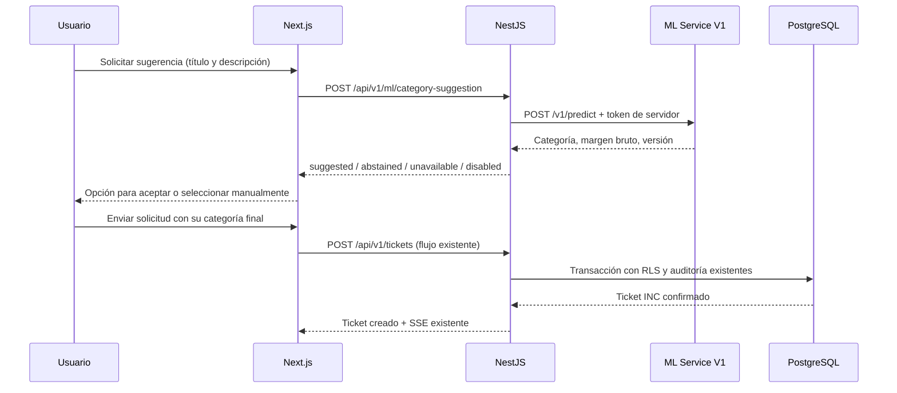

# Subetapa 4.7 — clasificación asistida dentro del formulario

La persona escribe título y descripción, solicita una sugerencia y decide si la acepta, descarta o cambia. Solo **Enviar solicitud** crea el ticket. Es un prototipo académico entrenado con datos sintéticos; el modelo no determina severidad, sede, técnico ni diagnóstico clínico.

## Flujo y responsabilidades



El navegador usa exclusivamente `/api/category-suggestion`, en su mismo origen. Next conserva la clave de API y la cookie HttpOnly en el servidor. Nest reutiliza las guardas y el permiso `tickets:create`, incluyendo el solicitante público actual. El puerto `CategoryClassifier` y el caso de uso `SuggestCategory` no dependen de PostgreSQL, Redis ni del repositorio de tickets. El adaptador HTTP es el único que conoce la URL/token ML.

La solicitud admite exactamente `{titulo, descripcion}`, recortados y válidos en UTF-8; API: 5–200 y 10–5000 caracteres. El formulario mantiene sus límites existentes 120/2000. Rechaza campos de identidad, sede, prioridad o categoría. Next exige Origin propio, limita el JSON a 32 KiB y filtra la respuesta. Nest admite únicamente el contrato de seis campos de Model V1 y un cuerpo ML máximo de 4096 bytes. Los secretos y el texto no aparecen en los logs nuevos.

## Resultado y significado del score

```json
{
  "status": "suggested",
  "suggestion": {
    "category": "BIOMEDICO",
    "score": 0.445,
    "scoreType": "raw_decision_margin_not_probability",
    "probability": null,
    "modelVersion": "ticket-category-model-v1.0.0",
    "policyVersion": "category-assistance-policy-v1.0.0"
  }
}
```

El JSON ilustra el contrato; no es una medición ni una probabilidad. Los otros tres estados devuelven `suggestion:null`. Nest responde 200 para esos estados de aplicación; Next convierte `unavailable` en HTTP 503 con un mensaje controlado. Una sesión inválida sigue devolviendo 401 y la falta de permiso 403.

La [política experimental](ASSISTANCE-POLICY-4.7.md) ofrece una opción si el margen máximo es ≥−0.06; debajo, se abstiene. Se obtuvo de las predicciones OOF de desarrollo de 4.4: 97/160 ofrecidas, 93 correctas y 63 abstenciones. Son mediciones de selección sobre datos sintéticos, **sin validación independiente del umbral**. No equivalen a confianza por ticket ni a rendimiento institucional. Model V1 no se reentrena y conserva `operational_threshold:null`; la política es externa y versionada.

La interfaz no muestra un porcentaje. Aceptar cambia únicamente el selector. El usuario puede cambiarlo otra vez antes de enviar. Editar el texto, cerrar o reabrir el formulario invalida/cancela una sugerencia anterior. Consultar ML no bloquea el envío manual. Los márgenes/versiones de respuesta dejan un contrato útil para futuro feedback; esta subetapa no guarda predicciones ni añade tablas de aprendizaje.

## Docker local, CMD paso a paso

Prerrequisito: la demostración de Etapa 3 y el contenedor ML de 4.6 fueron verificados. El usuario confirmó Docker y Actions de 4.6 en verde el 2026-10-10. No se repiten migraciones ni seeds: 4.7 no cambia el esquema ni los datos.

1. Abre Docker Desktop y espera a que el motor esté disponible. Abre CMD:

```cmd
cd /d "C:\Users\Stev\Pictures\SISTEMA DE TICKET\essalud-ticket-system"
npm.cmd run ml:service:stop
npm.cmd run ml:service:setup
npm.cmd run ml:integration:setup
npm.cmd run ml:integration:config
npm.cmd run ml:integration:up
npm.cmd run ml:integration:status
npm.cmd run ml:integration:check
```

2. Debe aparecer `ML_INTEGRATION_CHECK_OK`. El checker prueba sugerencia pública y autenticada, abstención, creación con una categoría **distinta** a la sugerida, lectura del ticket, persistencia real en PostgreSQL y auditoría INSERT/DELETE. Elimina exclusivamente su ticket temporal y deja el historial de auditoría. Produce `ml/outputs/integration-check.json` sin textos ni secretos. El ML no crea ningún registro. La comprobación consume un código INC: los huecos tras eliminar un ticket de prueba son normales.

3. Comprueba la independencia de ML:

```cmd
npm.cmd run ml:integration:stop-ml
npm.cmd run ml:integration:check -- --unavailable
npm.cmd run ml:integration:start-ml
npm.cmd run ml:integration:check
npm.cmd run demo:check
```

El chequeo de ML detenido debe devolver `ML_INTEGRATION_CHECK_OK` y confirmar creación manual/persistencia/auditoría. El último comando conserva las comprobaciones anteriores de interfaz, asignación y SSE. Si falla un paso, revisa `npm.cmd run ml:integration:logs` y comparte únicamente el error controlado, nunca los `.env`. No avances a 4.8 hasta verificarlo.

`compose.ml-integration.yaml` extiende el servicio aislado de 4.6 dentro del proyecto Compose existente y la red `backend`. No mezcla el `name: essalud-ml-local` del archivo independiente; conserva los volúmenes PostgreSQL/Redis. El backend no tiene una dependencia obligatoria de salud ML. Se detiene primero el ML aislado porque usa el mismo puerto localhost:8001. Usa `ml:integration:up` después de cambiar la configuración: recrea API/web y carga las variables actuales.

## Configuración y límites

| Variable exclusiva de Nest | Valor local |
| --- | --- |
| `ML_ASSIST_ENABLED` | `true` en el overlay; por defecto `false` |
| `ML_SERVICE_URL` | `http://ml:8001` |
| `ML_SERVICE_TOKEN` | Token conservado desde `ml/outputs/service.env` |
| `ML_SERVICE_TIMEOUT_MS` | `4000`, válido entre 3000 y 4500 |

`ml:integration:setup` escribe solo estas cuatro variables en `ml/outputs/integration.env`, ignorado por Git. No rota credenciales ni modifica `.env.tickets`. El token ML debe ser distinto de las claves de API/JWT. No crear variables `NEXT_PUBLIC_ML_*`. El flujo mantiene presupuesto: proceso ML 2 s; Nest 4 s; Next 5 s; navegador 10 s. Las redirecciones y respuestas inesperadas se rechazan. La readiness principal sigue midiendo PostgreSQL/Redis; ML es opcional.

Para desactivarlo por configuración, cambia **solo** `ML_ASSIST_ENABLED=true` a `false` en `ml/outputs/integration.env`, guarda, ejecuta `ml:integration:up` y `ml:integration:check -- --disabled`. Restaurar: `ml:integration:setup`, `ml:integration:up`, `ml:integration:check`. No publicar ese archivo. No se cambia el despliegue público en esta entrega; se analiza en 4.9.

## Demostración manual importante

1. Abre `http://localhost:3000/portal` → **Reportar incidencia**. Elige una sede y área DEMO. Título: **Monitor de signos sin lectura**. Descripción: **El monitor multiparámetro no registra la saturación con el sensor conectado y muestra una alarma técnica del equipo.**
2. Pulsa **Solicitar sugerencia**. Debe ofrecer **Equipamiento biomédico**, con aviso experimental. Antes de aceptar, el selector conserva su valor. Acepta; cambia manualmente si deseas y pulsa **Enviar solicitud**. Guarda el código INC y consulta el ticket en el tablero autorizado.
3. Para abstención: título **La aplicación no abre**; descripción **Al iniciar el programa de ofimática aparece un error y se cierra; otros programas de la computadora funcionan.** Debe permitir elegir manualmente sin botón de aceptación. Estos son ejemplos ficticios de comprobación; la abstención no demuestra que la etiqueta original sea incorrecta.
4. Detén ML con `ml:integration:stop-ml`, solicita otra sugerencia y crea un ticket manual. Luego restaura con `ml:integration:start-ml`. En DevTools → Network, la petición va a `/api/category-suggestion`; su cuerpo contiene solo título/descripción y no contiene claves ML/API ni IDs de sede/tenant.

## GitHub y evidencias

Se trabaja en `main`, conservando cambios previos del usuario fuera del commit de esta entrega. No usar `git add .` para añadir archivos accidentales. Tras revisar el commit local:

```cmd
git status --short
git log -1 --oneline
git push origin main
```

Actions → **Infrastructure CI** incorpora la prueba Compose de 4.7 y el fallback. **ML Inference CI** sigue comprobando el servicio aislado. Espera verde; esto no despliega ni migra automáticamente una plataforma. Conserva:

- Captura del formulario con sugerencia y aviso sintético, antes y después de aceptar.
- Captura de cambio manual y ticket creado con su código INC.
- Captura de abstención y de creación manual con ML detenido.
- Consola `ML_ASSISTANCE_POLICY_OK`, `ML_INTEGRATION_CHECK_OK` y servicios saludables; sin variables/credenciales.
- Artifact de Actions `stage-4.7-integration-check`, recibos locales y workflow verde.
- Diagrama del flujo y política OOF, aclarando sus limitaciones.

Dataset V1, los 20 tickets DEMO y Model V1 mantienen su separación. No se insertan los 200 ejemplos ML en PostgreSQL. SLA, Node-RED, IA avanzada, CMDB, historial paginado y cambio de hosting quedan en las subetapas autorizadas futuras.
